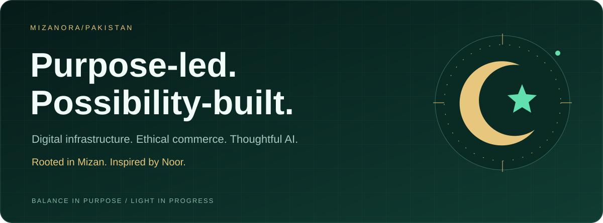
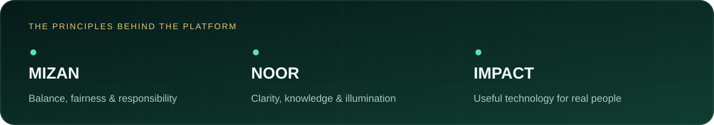
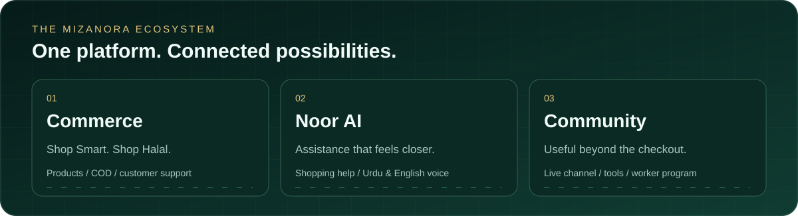

### Building technology with balance. Creating experiences with light.

**Mizanora** is a Pakistan-based organization building digital infrastructure, 
halal e-commerce and ethical AI systems—rooted in **Mizan** (balance) and **Noor** (illumination).

[**Explore Mizanora ↗**](https://mizanora.vercel.app/) · [**Our code ↗**](https://github.com/Mizanora-org) · [**Get in touch ↗**](mailto:mezanora.market@gmail.com)

**[Purpose](#our-purpose) · [Ecosystem](#the-ecosystem) · [Flagship](#flagship--mizanora) · [Technology](#technology-foundation) · [Collaborate](#build-with-us)**

## Our purpose

Great technology should make everyday life clearer, fairer and more accessible. We are building Mizanora around that belief: connecting practical digital services with responsible commerce and human-centered assistance.

> **Mizan gives us balance. Noor gives us direction. Mizanora brings them together.**

- **Purpose before complexity.** Solve practical problems, not just technical ones.
- **Clarity before confusion.** Make information, shopping and support easier to navigate.
- **Responsibility by design.** Let fairness and ethical intent guide what we build.
- **Local understanding, broader ambition.** Start with the needs of people in Pakistan and build with care.

## The ecosystem

Mizanora's public flagship brings these experiences together in **one platform**. The areas below are platform capabilities, not separate released repositories.

| Area | What it brings together |
| :--- | :--- |
| **Halal e-commerce** | Product discovery, a mobile-friendly storefront, cash on delivery and WhatsApp support. |
| **Noor AI** | Shopping assistance with Urdu and English voice features, designed around customer questions. |
| **Live & knowledge** | A Quran and Hadith live-channel experience alongside the wider platform. |
| **Everyday utilities** | Free tools and practical content that extend the experience beyond shopping. |
| **Worker program** | Product-sharing and selling workflows, supported by dedicated platform tools. |
| **Digital infrastructure** | Catalog, search, administration and integration systems behind the experience. |

## Flagship — MIZANORA

### Shop Smart. Shop Halal.

Our flagship project connects commerce, assistance and useful services in a single web experience for Pakistani users.

**[Visit the platform →](https://mizanora.vercel.app/)** &nbsp; **[Explore the repository →](https://github.com/Mizanora-org/MIZANORA)**

| Discover | Explore |
| :--- | :--- |
| **Storefront** | [Browse products](https://mizanora.vercel.app/products) |
| **Live channel** | [Explore Quran & Hadith programming](https://mizanora.vercel.app/live-channel) |
| **People** | [Meet the team](https://mizanora.vercel.app/team) |
| **Development** | [Read the project documentation](https://github.com/Mizanora-org/MIZANORA#readme) |
| **Feedback** | [Browse issues](https://github.com/Mizanora-org/MIZANORA/issues) |

Repository badges are provided by Shields.io and may be cached. They are not platform uptime indicators.

## Technology foundation

A modern web stack supports the flagship's storefront, media, integrations and administrative workflows.

| Layer | Technologies in the public project |
| :--- | :--- |
| **Application** | Next.js 15 · React 19 · JavaScript |
| **Interface** | Tailwind CSS 3 · Lucide icons · installable PWA |
| **Data & services** | Firebase · Firestore · Realtime Database · Firebase Admin |
| **Media** | HLS.js · dash.js · live-channel tooling |
| **Quality & tooling** | Node.js 20+ · TypeScript tooling · project check and test scripts |

**Explore the implementation:** [package manifest](https://github.com/Mizanora-org/MIZANORA/blob/HEAD/package.json) · [setup guide](https://github.com/Mizanora-org/MIZANORA/blob/HEAD/SETUP.md) · [source code](https://github.com/Mizanora-org/MIZANORA)

## People behind the purpose

Mizanora was founded by **[Muaaz Iqbal](https://github.com/muaaziqbalvip)**, a developer, AI researcher and marketer from **Kasur, Punjab, Pakistan**.

The platform reflects a practical focus: build useful digital experiences, understand local users and connect thoughtful technology with everyday needs.

**[Read the founder story →](https://mizanora.vercel.app/blog/who-is-muaaz-iqbal-founder-of-mizanora)**

## Build with us

Interested in practical software, accessible experiences or responsible AI? Start with the flagship project and help improve something real.

1. **Explore** the [source and documentation](https://github.com/Mizanora-org/MIZANORA#readme).
2. **Discuss** a reproducible bug or focused suggestion through [project issues](https://github.com/Mizanora-org/MIZANORA/issues).
3. **Contribute** a focused change with a clear explanation and relevant checks. Review the target repository's contribution and license terms first.
4. **Connect** by email for collaborations, partnerships or general questions.

Useful areas to explore include documentation, accessibility, Urdu/English user experience, testing and developer tooling. Please do not post credentials, customer information or other sensitive data in public issues.

### Let's make meaningful progress.

**[Website](https://mizanora.vercel.app/) · [GitHub organization](https://github.com/Mizanora-org) · [Email](mailto:mezanora.market@gmail.com)**

Balance in purpose. Light in progress.

---

About this showcase · sources, animation & organization setup

Organization and project details were reviewed on **30 October 2026** using the [public organization profile](https://github.com/Mizanora-org), [flagship README](https://github.com/Mizanora-org/MIZANORA#readme), [package manifest](https://github.com/Mizanora-org/MIZANORA/blob/HEAD/package.json) and founder article linked above. Capabilities are described from public documentation; this showcase does not independently certify halal compliance, security, uptime or AI performance.

The animated artwork is local SVG: no JavaScript, external fonts or animation API is required. Motion is decorative, content remains readable without animation, and each asset supports `prefers-reduced-motion`. Optional Shields.io badges are the only third-party image dependency.

To regenerate artwork: `python3 scripts/build-art.py`.

To publish this on the **organization homepage**, see [the deployment guide](docs/ORGANIZATION-SETUP.md). This repository's README alone does not configure the organization profile.

